# KodBTW

### Unified Coding Identity & Campus Coding Intelligence Platform

<p align="center">
  <a href="https://github.com/sajalgoyal007/KodBTW"></a>
  
  
  
  
</p>

<p align="center">
  <strong>One place to connect coding profiles, understand available statistics, and follow recorded progress.</strong><br>
  <a href="https://kodbtw.vercel.app">Open KodBTW</a> ·
  <a href="https://github.com/sajalgoyal007/KodBTW">Source repository</a> ·
  <a href="#project-documents--deliverables">Project documents</a>
</p>

> **Data note:** each platform reports different fields and uses different rating scales. KodBTW keeps source and availability context visible; an unavailable value is not treated as zero. The landing-page preview uses sample data, and live platform coverage depends on the enabled adapter.

---

## Contents

- [Project administration](#project-administration)
- [Team roster](#team-roster)
- [Abstract](#abstract)
- [Problem, goals, and scope](#problem-goals-and-scope)
- [User roles and access](#user-roles-and-access)
- [Requirements at a glance](#requirements-at-a-glance)
- [System architecture](#system-architecture)
- [Functional modules](#functional-modules)
- [Platform integration status](#platform-integration-status)
- [Database design](#database-design)
- [Security and non-functional considerations](#security-and-non-functional-considerations)
- [Team-wise role and contribution focus](#team-wise-role-and-contribution-focus)
- [Integration and validation](#integration-and-validation)
- [Screenshots](#screenshots)
- [Repository structure](#repository-structure)
- [Run locally](#run-locally)
- [API overview](#api-overview)
- [Project documents & deliverables](#project-documents--deliverables)
- [Limitations and future work](#limitations-and-future-work)
- [License](#license)

## Project administration

| Item | Details |
|---|---|
| Project title | **KodBTW — Unified Coding Identity & Campus Coding Intelligence Platform** |
| Project code | `PBL2627-CSE-C-064` |
| Course | Project Based Learning / Advanced Java Laboratory (Java Projects), 5th Semester |
| Department | Computer Science & Engineering |
| Institution | Arya College of Engineering & Information Technology, Jaipur, Rajasthan |
| Academic session | 2026–27 |
| Project guide | Er. Ram Babu Buri, Department of CSE |
| Project period | 6 July 2026 – 6 October 2026 |
| Application | [kodbtw.vercel.app](https://kodbtw.vercel.app) |
| Source code | [github.com/sajalgoyal007/KodBTW](https://github.com/sajalgoyal007/KodBTW) |

The academic details and enrollment IDs below are transcribed from supplied project documents. Confirm spelling, enrollment-ID format, and institutional details against college records before final submission.

## Team roster

| Member | Enrollment ID (as listed in report) | Team role focus |
|---|---|---|
| Sajal Goyal | `24EARCS142` | Team lead; API and authentication |
| Shri Krishna Chandra Vaishnav | `24EARCS157` | Frontend application and user experience |
| Yug Mittal | `24EARCS189` | Platform integrations and statistics synchronization |
| Ravi Shah | `24EARCS130` | Database, persistence, and analytics |
| Suryadev Singh | `24EARCS170` | Quality, contest calendar, and documentation |

## Abstract

Coding identity and activity are spread across competitive-programming platforms. KodBTW is a full-stack web application that lets a developer connect platform handles, view statistics available from enabled sources, retain dated snapshots, and review them through dashboards, analytics, a contest calendar, leaderboard views, and an optional public profile.

The user interface is built with React and TypeScript. The backend is a Java 21 / Spring Boot REST API with Spring Security, JWT authentication, Spring Data JPA, MySQL 8, and Flyway. Platform adapters normalize the fields each source actually provides. Source labels and nullable statistics preserve provenance and missing-data meaning across synchronization and history views.

KodBTW is an engineering project and a progress-viewing tool. The repository does not establish learning-outcome benefits, user-study results, or authorization from third-party platforms.

## Problem, goals, and scope

### Problem statement

Developers who practise on several coding platforms have to visit separate sites to review their profiles and progress. Metrics do not share common definitions, some sources omit fields, and a current profile page does not by itself provide a historical timeline. Combining these values without their source or availability context can create misleading comparisons.

### Project goals

- Provide registration, login, and owner-scoped profile management.
- Let users store their coding-platform handles and synchronize supported public statistics.
- Preserve successful observations as dated, source-labelled snapshots.
- Present available values through dashboard, analytics, history, leaderboard, and contest views.
- Offer a public profile through a dedicated, sanitized response model.
- Represent unavailable values as unavailable instead of inventing zeroes or estimated history.

### Scope boundaries

KodBTW includes a React frontend, Spring Boot REST API, MySQL persistence, Flyway migrations, platform adapters, and local development configuration. It does not guarantee external provider uptime, establish third-party permission to collect or redistribute data, or claim campus-wide monitoring and mentor dashboards as implemented features.

## User roles and access

| Role | Access |
|---|---|
| Visitor | Register or log in, check the public health endpoint, and view public profiles exposed through the public profile route. |
| Registered developer | Manage their own profile and platform accounts; view their dashboard, analytics, history, contest information, and leaderboard views. Account operations are scoped to the authenticated user. |
| Administrator | Has the `ADMIN` authority required for the manual leaderboard-cache synchronization endpoint. |

Public profile data is returned through a dedicated response DTO rather than by exposing a database user entity. Frontend route guards improve navigation flow; backend authorization remains the authority for protected API operations.

## Requirements at a glance

The [Software Requirements Specification](documentation/project-deliverables/KodBTW_SRS_Supplied.pdf) describes the implemented API surface and its constraints. The table below summarizes the user-visible requirements represented by the current project documentation.

| ID | Requirement | Implementation area |
|---|---|---|
| FR-01 | Register, verify email, and authenticate a user | Authentication API and frontend auth pages |
| FR-02 | Connect and manage platform handles for the signed-in user | Platform-account API and Coding Profiles page |
| FR-03 | Synchronize available statistics from enabled sources | Adapter registry, provider clients, sync service |
| FR-04 | Store dated observations with source and sync status | Snapshot persistence and Flyway-managed schema |
| FR-05 | Show dashboard, comparison, history, and insights views | Dashboard API and frontend analytics pages |
| FR-06 | Show upcoming contests and platform standings where available | Contest provider and contest calendar API |
| FR-07 | Provide paginated leaderboard views | Leaderboard API and cached projection |
| FR-08 | Share a public developer profile | Public profile endpoint and `/u/:username` route |
| FR-09 | Allow Google sign-in and account linking flows | Google authentication and challenge endpoints |

## System architecture

KodBTW uses a browser-based React single-page application and a stateless Spring Boot API. Controllers validate and route requests to services; repositories persist application data through JPA. Platform synchronization selects an adapter, requests provider data, maps supported fields, and stores dated snapshots. Missing provider fields remain null.

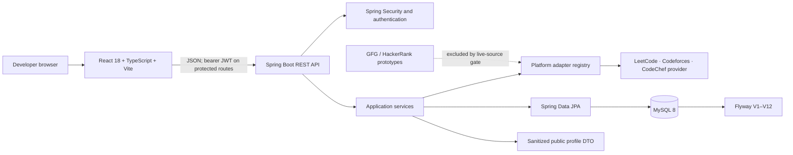

### Architecture figures

These images were extracted from the supplied final project report. Editable design sources are available in the [architecture](documentation/diagrams/architecture/SYSTEM_ARCHITECTURE.md), [system design](documentation/diagrams/system-design/README.md), and [UML](documentation/diagrams/uml/README.md) documentation.

<details>
<summary>Layered architecture, sync workflow, and entity relationships</summary>

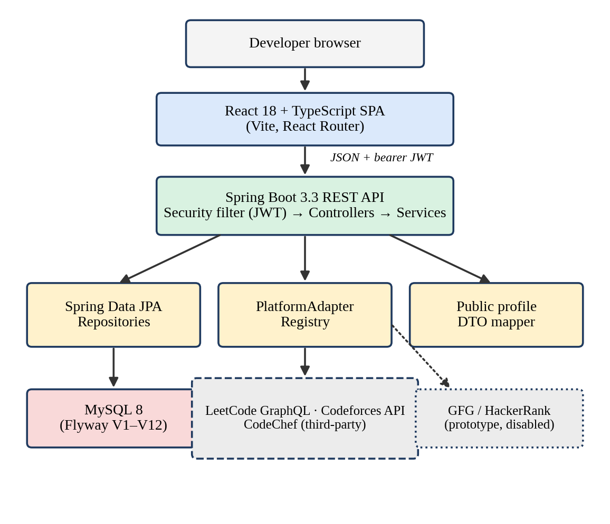

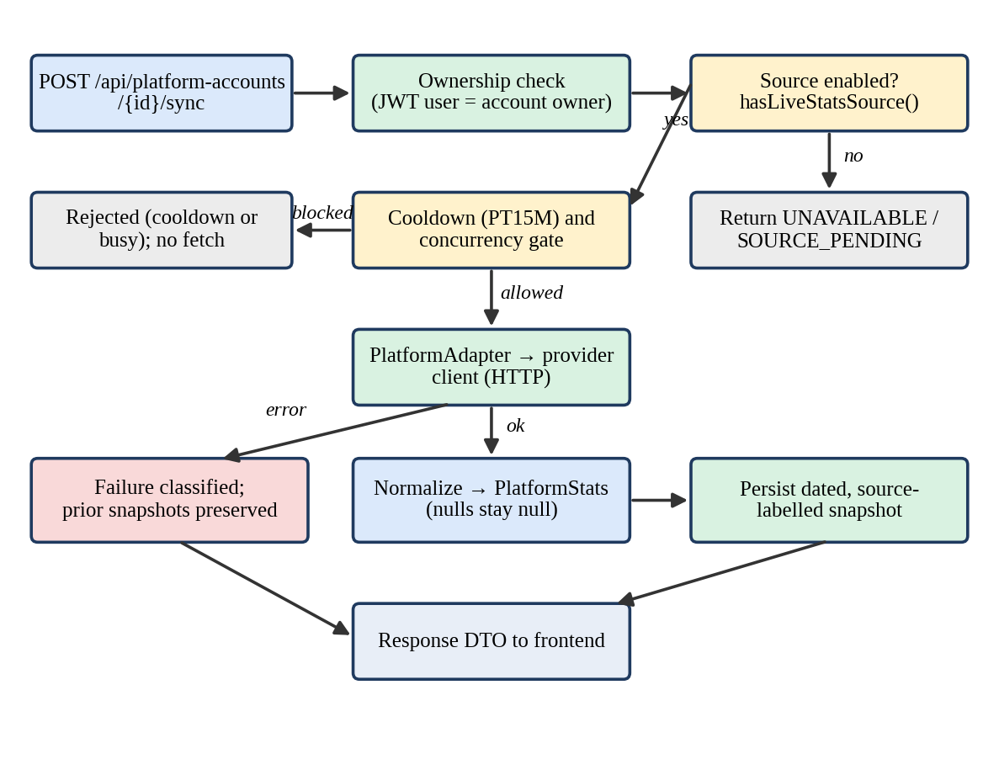

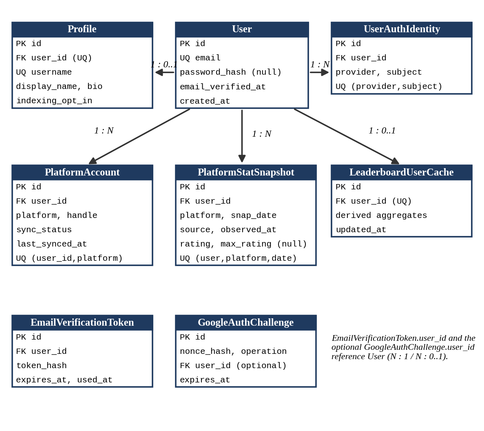

</details>

## Functional modules

| Module | Main responsibilities | Key code areas |
|---|---|---|
| Authentication and identity | Registration, login, JWT validation, email verification, Google authentication/linking | `backend/src/main/java/com/kodbtw/controller/AuthController.java`, `service/`, `security/`, `config/SecurityConfig.java` |
| Developer profiles | Owner profile management, unique public username, safe public response | `ProfileController.java`, `PublicProfileController.java`, profile services and DTOs |
| Platform accounts and synchronization | Handle management, ownership checks, source selection, sync status, provider error handling | `PlatformAccountController.java`, `PlatformAccountService.java`, `PlatformSyncService.java`, `adapter/` |
| Dashboard and analytics | Summary statistics, difficulty/platform breakdown, history, insights, activity and contest intelligence | `DashboardController.java`, `service/Dashboard*Service.java`, analytics/history/insights DTOs |
| Leaderboard | Global, college, and current-user views; cached ranking projection | `LeaderboardController.java`, `LeaderboardService.java`, `LeaderboardSyncService.java` |
| Contest calendar | Upcoming contest data, local-time display, source and cache status | `ContestCalendarController.java`, `ContestCalendarService.java`, `adapter/contest/` |
| Frontend experience | Protected routes, profile pages, dashboards, responsive UI, theme, loading and error states | `frontend/src/App.tsx`, `frontend/src/pages/`, `frontend/src/components/` |

### Primary user journeys

1. **Create an account:** a visitor submits registration information. The API validates it, stores a BCrypt password hash, and supports the email-verification flow before account use.
2. **Sign in:** the user authenticates with the supported login flow and receives a JWT. Protected API requests carry the token in the authorization header.
3. **Connect and synchronize a handle:** an authenticated user adds a platform account. The API checks ownership, verifies that the source is enabled, applies synchronization controls, maps available provider fields, and records a source-labelled snapshot after a successful sync.
4. **Review progress:** dashboard and analytics endpoints return the user’s stored observations. Missing values remain unavailable, and history reflects recorded snapshots rather than interpolated values.
5. **Share a profile:** a visitor requests a public username. The API returns only fields in the public profile response model.

## Platform integration status

| Platform | Current repository status | Data boundary |
|---|---|---|
| LeetCode | Live profile-statistics adapter | Uses a reachable but undocumented GraphQL endpoint. Only fields present in the response are mapped; the external contract and terms require ongoing review. |
| Codeforces | Live profile adapter using public `user.info`; Codeforces contest provider | The user endpoint does not provide all activity or solved-count fields. Missing values remain null. |
| CodeChef | Adapter uses an unofficial third-party statistics provider | Not an official CodeChef API. Authorization, data rights, provider reliability, and upstream permissions are unresolved. |
| GeeksforGeeks | Adapter/client prototype files exist | Excluded by the normal live-source gate; not enabled for normal statistics synchronization. |
| HackerRank | Adapter/client prototype files exist | Excluded by the normal live-source gate; not enabled for normal statistics synchronization. |

The platform catalog therefore should not be interpreted as five live integrations. Source labels such as `LEETCODE_REAL`, `CODEFORCES_REAL`, and `CODECHEF_THIRD_PARTY` identify the origin path used by the application. See the [data-acquisition notes](docs/platform-data-acquisition.md) and [integration design](documentation/diagrams/platform-integration/README.md).

## Database design

MySQL 8 stores account, profile, platform-account, snapshot, and leaderboard-cache data. Flyway owns schema evolution; Hibernate validates the migrated schema rather than creating it. The [ER figure](documentation/diagrams/assets/entity-relationship-overview.png) gives an overview; migration SQL under `backend/src/main/resources/db/migration/` is the authoritative schema source.

| Entity | Purpose | Important relationship or invariant |
|---|---|---|
| `User` | Login identity and account metadata | Unique email; password hash may be absent for linked identity flows. |
| `Profile` | Display name, bio, public username, indexing preference | One profile per user; public username is unique. |
| `UserAuthIdentity` | External authentication identity | Provider and subject identify a linked identity. |
| `PlatformAccount` | A user’s handle on a coding platform | Owner-scoped; unique per user and platform. |
| `PlatformStatSnapshot` | Dated values observed during successful synchronization | Stores source, observation time, and nullable metrics. |
| `LeaderboardUserCache` | Derived leaderboard projection | Optional one-to-one cached projection per user. |
| `GoogleAuthChallenge` | Short-lived Google login/link operation state | Bound to an operation and, when appropriate, an account. |
| `EmailVerificationToken` | Hashed, expiring verification token | Associated with a user; token lifecycle is tracked. |

### Migration sequence

| Migration | Schema change |
|---|---|
| V1–V3 | Initial schema, users, profiles, and platform accounts |
| V4–V7 | Leaderboard snapshots, profile usernames, sync status, and separate maximum rating |
| V8–V9 | Opt-in profile search indexing and external authentication identity |
| V10–V11 | Google authentication challenges and operation/user binding |
| V12 | Email verification support |

See the [database design notes](documentation/diagrams/database/README.md) for constraints and the full ER diagram source.

## Security and non-functional considerations

| Area | Design decision |
|---|---|
| Authentication | Stateless bearer JWTs; BCrypt password hashing; Google flows use server-side challenge state. |
| Authorization | Protected API operations resolve the authenticated user and scope account operations to that owner. The admin-only leaderboard sync is separately guarded. |
| Data exposure | Public profiles use a dedicated response DTO; API errors avoid returning persistence entities. |
| Data integrity | Flyway migrations define schema changes; nullable statistics preserve missing-field semantics. |
| Resilience | Sync status and provider errors are surfaced; failed synchronization preserves earlier successful observations. |
| External data | Provider fields, freshness, and live-source availability vary; third-party terms and permissions need separate review. |
| Accessibility and layout | The frontend includes responsive layouts, theme support, keyboard semantics, and automated markup/contrast checks; this does not replace a full assistive-technology audit. |

## Team-wise role and contribution focus

The role allocation below is the team-provided focus for explaining the project. It maps each member to a subsystem and its relevant implementation areas; it is not a claim of verified commit-by-commit ownership. The supplied final report and [contribution evidence matrix](documentation/TEAM_CONTRIBUTIONS.md) both state that individual ownership should be confirmed with the team before formal submission.

### 1. Sajal Goyal — Team lead, API, and authentication

**Role focus:** authentication and the backend API boundary.

- Explain registration, login, email verification, and Google sign-in/linking routes.
- Walk through JWT issuance and validation, BCrypt password storage, and protected request flow.
- Describe how controllers delegate to services and how authenticated identity is resolved for owner-scoped actions.
- Relevant areas: `AuthController`, `AuthService`, `UserService`, `security/`, `SecurityConfig`, and authentication DTOs under `backend/src/main/java/com/kodbtw/`.

### 2. Shri Krishna Chandra Vaishnav — Frontend application and user experience

**Role focus:** React routes, pages, and the experience for logged-in users.

- Present the dashboard, analytics, contest, leaderboard, and coding-profile views.
- Explain auth-aware navigation, API client behavior, and loading, error, and empty states.
- Show responsive layout and theme handling across the application.
- Relevant areas: `frontend/src/App.tsx`, `frontend/src/pages/`, `frontend/src/components/`, `frontend/src/context/`, and `frontend/src/services/api/`.

### 3. Yug Mittal — Platform integrations and statistics synchronization

**Role focus:** adapting provider responses into KodBTW’s platform-statistics model.

- Explain the adapter registry and the distinction between enabled integrations and prototype adapters.
- Walk through handle lookup, provider response mapping, source labels, sync statuses, and cooldown behavior.
- Describe why unsupported or missing statistics stay unavailable instead of being filled with estimates.
- Relevant areas: `backend/src/main/java/com/kodbtw/adapter/`, `PlatformAdapterRegistry`, `PlatformSyncService`, and platform-statistics DTOs.

### 4. Ravi Shah — Database, persistence, and analytics

**Role focus:** schema evolution, JPA persistence, historical snapshots, and derived views.

- Explain Flyway migrations and the account/profile/snapshot relationships.
- Describe how dated observations support history and how nullable data is handled by analytics.
- Walk through leaderboard projection and the distinction between stored source observations and derived rankings.
- Relevant areas: `backend/src/main/resources/db/migration/`, `entity/`, `repository/`, analytics services, and leaderboard services.

### 5. Suryadev Singh — Quality, contest calendar, and documentation

**Role focus:** contest data behavior, reliability states, tests, and project documentation.

- Explain the Codeforces contest provider, cache behavior, and the optional local fixture mode.
- Present stale, unavailable, and provider-failure states and how they are communicated to users.
- Describe the backend/frontend validation inventory and the limits of the historical test record.
- Relevant areas: `adapter/contest/`, `ContestCalendarService`, `frontend/tests/`, and `documentation/`.

### Module distribution summary

| Member focus | Main modules | Demonstration artifact |
|---|---|---|
| Sajal Goyal | Identity, authentication, API security | Registration/login and protected API flow |
| Shri Krishna Chandra Vaishnav | Frontend routes, dashboard, and interaction states | Dashboard and analytics screenshots |
| Yug Mittal | Platform adapters and synchronization | Platform status and sync workflow diagrams |
| Ravi Shah | MySQL schema, snapshots, analytics, leaderboard projection | ER diagram and recorded-history views |
| Suryadev Singh | Contest calendar, quality records, and documentation | Contest screenshot, validation record, deliverable index |

Enrollment IDs are copied from the supplied final report; the exact format should be checked with the college before submission. Do not use commit counts alone to assign individual ownership.

## Integration and validation

The project combines frontend routes, authenticated API calls, provider adapters, persistence, and dashboard projections. Important integration boundaries include:

1. The frontend and backend agree on authentication, DTO shapes, and error states.
2. The sync service enforces account ownership and enabled-source checks before contacting a provider.
3. Provider-specific nullable fields remain nullable when converted to normalized statistics and snapshots.
4. Dashboard, analytics, public-profile, leaderboard, and contest responses use distinct access and data rules.

The repository contains backend unit/controller/security and migration checks, frontend utility/API tests, and a backend GitHub Actions workflow. See [Testing and Validation](documentation/TESTING_AND_VALIDATION.md) for dated historical results and environment limitations. **Tests were not rerun while updating this README.** Historical results are not a claim about the current deployed site or current working tree.

## Screenshots

These captures were supplied for the project README. Dashboard, analytics, contest, leaderboard, and profile values reflect a point in time and may change. The landing page labels its preview values as illustrative sample data.

<details>
<summary>Landing page and product overview</summary>

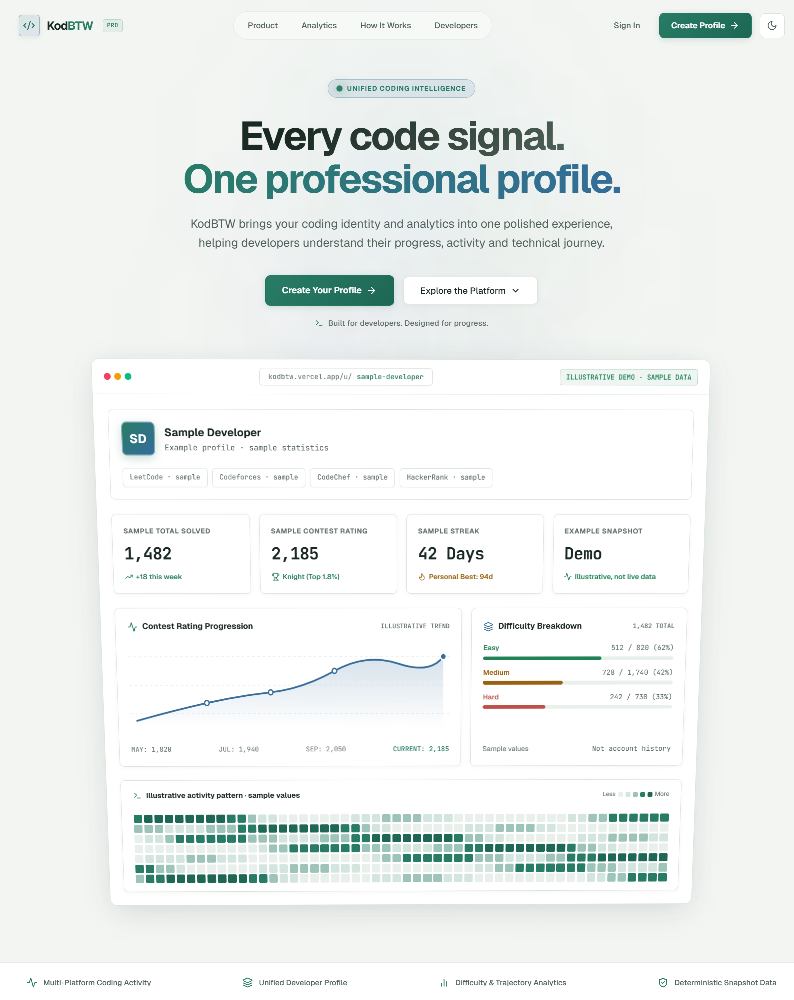

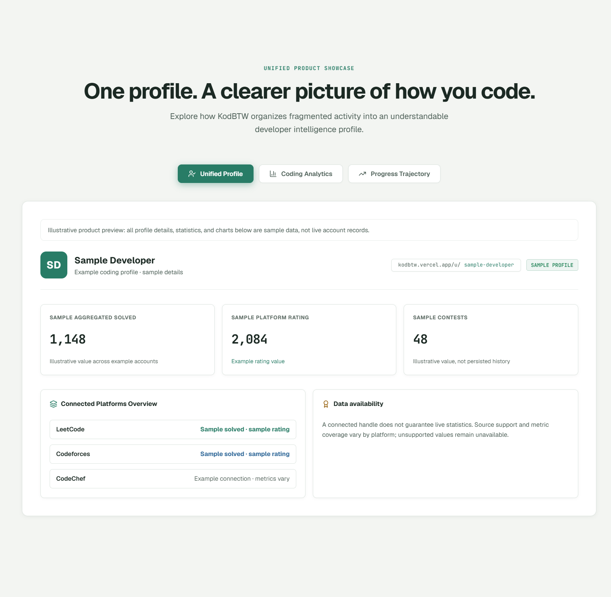

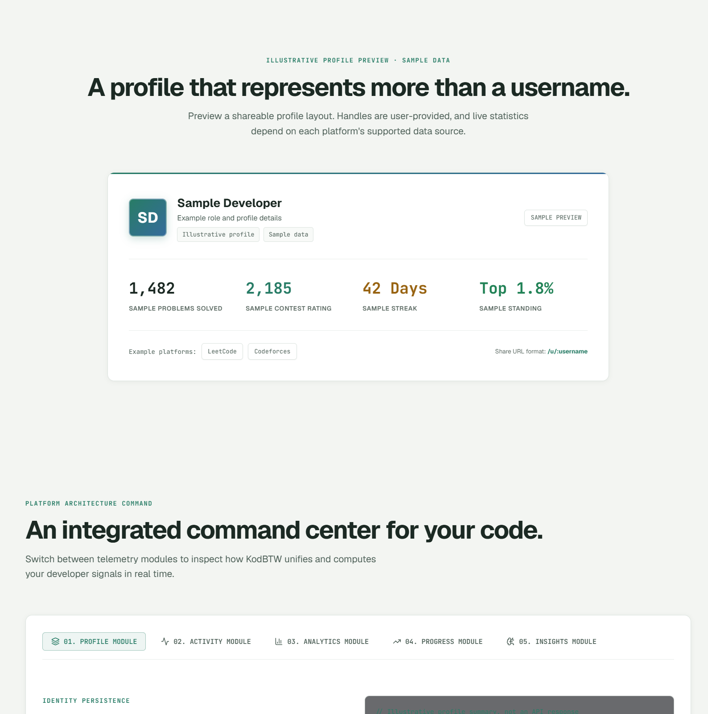

</details>

<details>
<summary>Developer dashboard</summary>

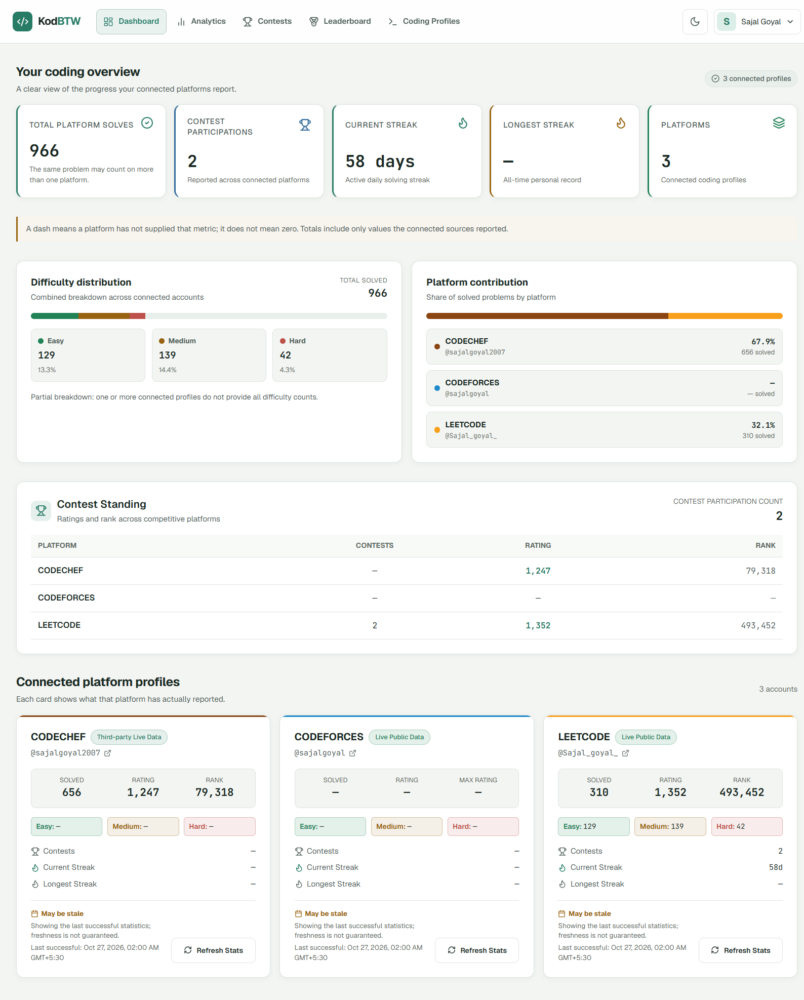

</details>

<details>
<summary>Analytics and insights</summary>

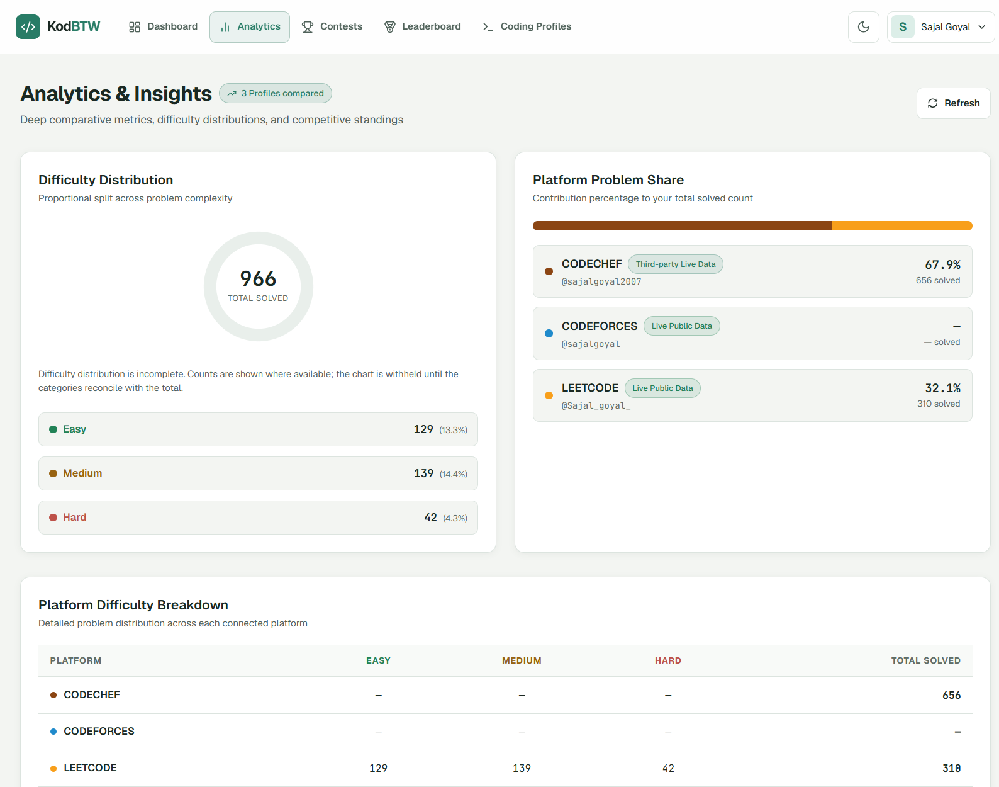

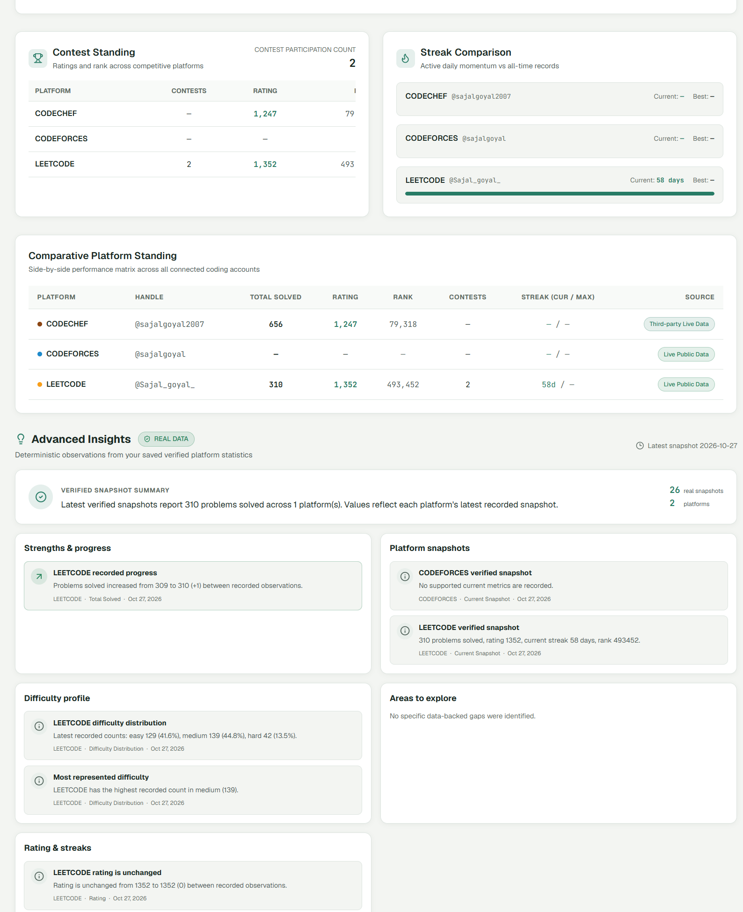

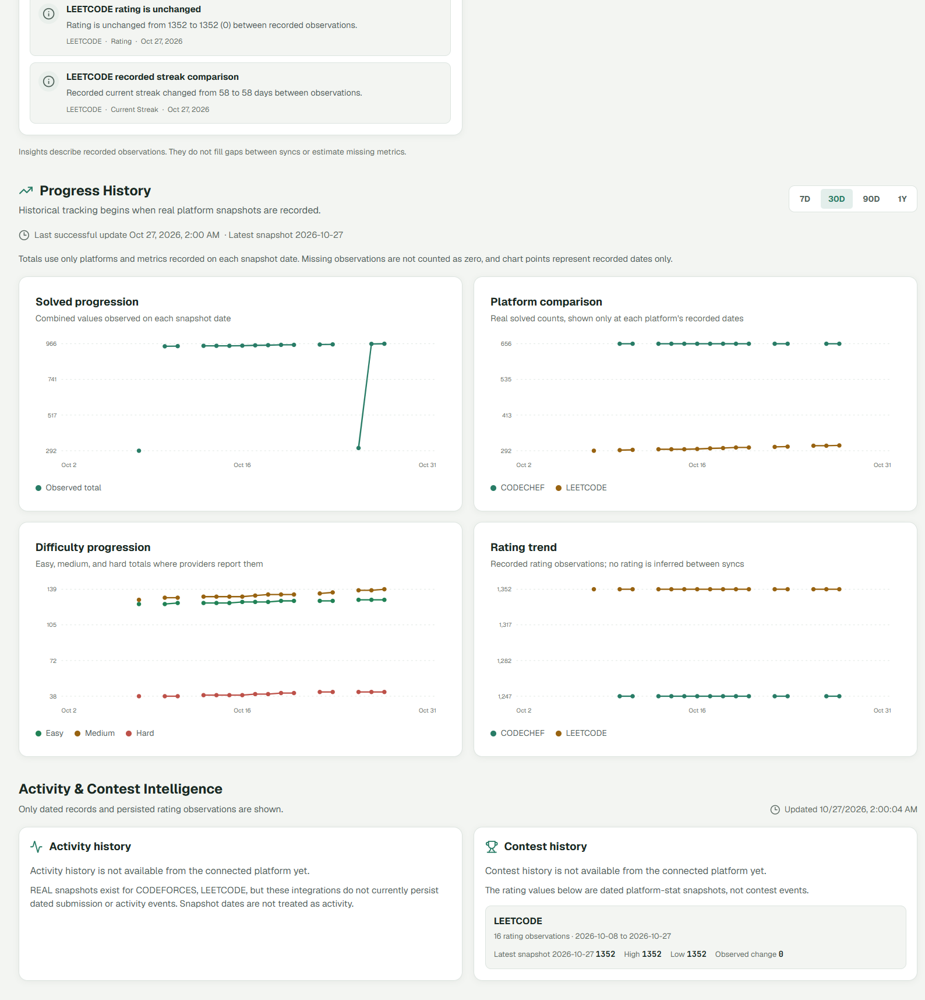

</details>

<details>
<summary>Contest calendar</summary>

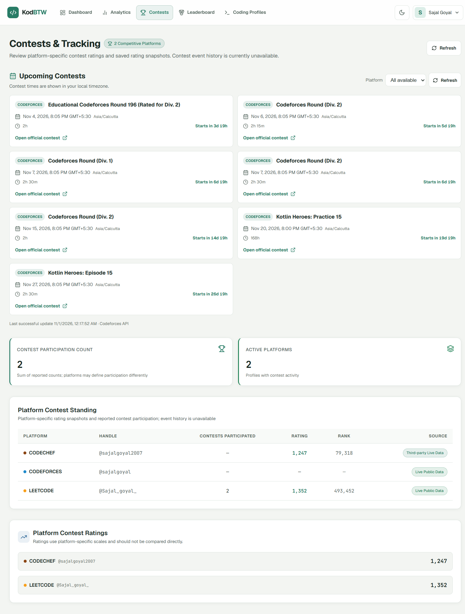

</details>

<details>
<summary>Leaderboard</summary>

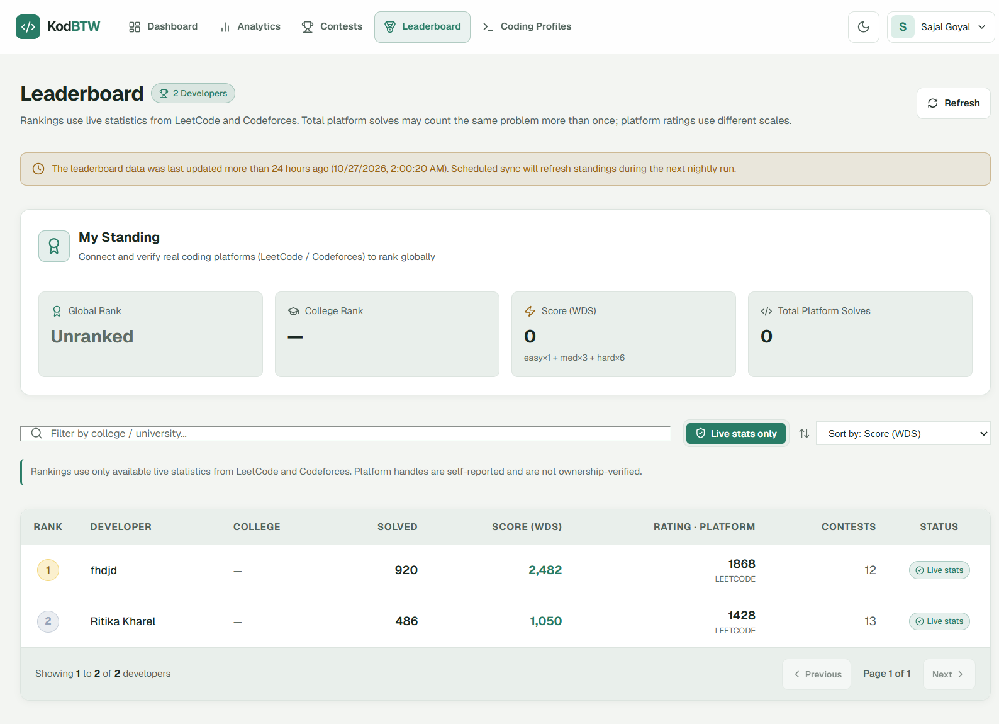

</details>

<details>
<summary>Coding profiles</summary>

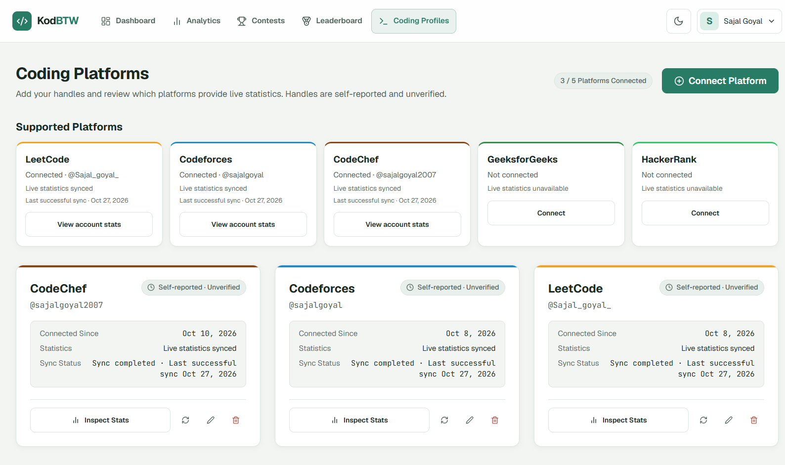

</details>

See the [screenshot index](documentation/screenshots/INDEX.md) for the capture list and limitations.

## Repository structure

```text
KodBTW/
├── backend/
│   └── src/
│       ├── main/java/com/kodbtw/       # Controllers, services, adapters, entities, DTOs
│       ├── main/resources/db/migration/ # Flyway schema history, V1–V12
│       └── test/                       # Backend automated tests and fixtures
├── frontend/
│   ├── public/                         # Static assets and SPA metadata
│   ├── src/                            # React pages, components, API clients
│   └── tests/                          # Node.js test suite
├── documentation/
│   ├── diagrams/                       # Architecture, ER, UML, sync diagrams
│   ├── project-deliverables/           # Report, SRS, paper, and presentation
│   ├── screenshots/                    # README screenshots and index
│   └── weekly-reports/                 # Progress-report index
├── docs/                               # Technical notes and data-source research
└── .github/workflows/                  # Backend CI workflow
```

## Run locally

### Prerequisites

- Java 21
- MySQL 8
- Node.js 18+ and npm
- Docker for the Testcontainers-backed database tests

Create a local development database:

```sql
CREATE DATABASE kodbtw CHARACTER SET utf8mb4 COLLATE utf8mb4_0900_ai_ci;
```

Set backend values in the process environment or a secret manager. `.env.example` is a reference, not an automatically loaded Spring configuration. Use local development credentials and a fresh JWT secret; do not commit populated environment files.

Example PowerShell configuration for a local MySQL service:

```powershell
$env:DB_URL = "jdbc:mysql://127.0.0.1:3306/kodbtw?useSSL=false&allowPublicKeyRetrieval=true&serverTimezone=UTC"
$env:DB_USERNAME = Read-Host "Local MySQL username"
$secureDbPassword = Read-Host "Local MySQL password" -AsSecureString
$env:DB_PASSWORD = [System.Net.NetworkCredential]::new("", $secureDbPassword).Password
$secretBytes = New-Object byte[] 32
[System.Security.Cryptography.RandomNumberGenerator]::Fill($secretBytes)
$env:JWT_SECRET = [Convert]::ToBase64String($secretBytes)
$env:CORS_ALLOWED_ORIGINS = "http://localhost:5173,http://127.0.0.1:5173"
```

Start the backend from `backend/`:

```powershell
.\mvnw.cmd spring-boot:run
```

Start the frontend from `frontend/` in another terminal:

```powershell
npm ci
npm run dev
```

The frontend uses Vite on port `5173` and proxies `/api` to the backend on port `8080`. Flyway applies migrations V1–V12; Hibernate validates the migrated schema. The default contest provider is Codeforces. The local fixture option is documented in [`docs/contest-calendar-fixture-mode.md`](docs/contest-calendar-fixture-mode.md).

## API overview

All API routes use the `/api` prefix. Routes described as protected require a bearer token. Controller annotations are the definitive route source.

| Method and route | Access | Purpose |
|---|---|---|
| `POST /api/auth/register` | Public | Create a KodBTW account |
| `POST /api/auth/verify-email` | Public | Verify an email address with a token |
| `POST /api/auth/resend-verification` | Public | Request another verification message |
| `POST /api/auth/login` | Public | Authenticate with account credentials |
| `POST /api/auth/google` | Public | Google sign-in flow |
| `POST /api/auth/google/challenge` | Public | Begin Google sign-in challenge flow |
| `POST /api/auth/google/link/challenge` | Protected | Begin account-linking challenge |
| `POST /api/auth/google/link` | Protected | Link a Google identity |
| `GET /api/auth/google/identity` | Protected | Read linked identity status |
| `GET /api/auth/me` | Protected | Read current authenticated user |
| `GET /api/health` | Public | Liveness endpoint; not a database-readiness check |
| `GET /api/profile`, `PUT /api/profile` | Protected | Read or update the current user's profile |
| `GET /api/public/profiles/{username}` | Public | Read a sanitized public profile |
| `/api/platform-accounts/**` | Protected | Create, list, inspect, update, delete, and sync owned handles |
| `/api/dashboard/{stats,analytics,history,insights,activity,contests}` | Protected | Read dashboard and history data |
| `GET /api/contests` | Protected | Read upcoming contest information |
| `GET /api/leaderboard`, `/college`, `/me` | Protected | Read leaderboard views |
| `POST /api/leaderboard/sync` | Admin | Rebuild the cached leaderboard projection |

See `backend/src/main/java/com/kodbtw/controller/` for request and response details.

## Project documents & deliverables

| Deliverable | File or link |
|---|---|
| Software Requirements Specification | [Supplied SRS PDF](documentation/project-deliverables/KodBTW_SRS_Supplied.pdf) · [Repository SRS PDF](documentation/project-deliverables/KodBTW_SRS.pdf) |
| Final project report | [Final report PDF](documentation/project-deliverables/KodBTW_Final_Project_Report_Explained_Review.pdf) · [Editable report DOCX](documentation/project-deliverables/KodBTW_Project_Report_Source.docx) |
| Research paper | [Research paper PDF](documentation/project-deliverables/KodBTW_Research_Paper.pdf) |
| Literature review | [Literature review PDF](documentation/project-deliverables/KodBTW_Literature_Review.pdf) |
| Project presentation | [Presentation PDF](documentation/project-deliverables/KodBTW_Project_Presentation.pdf) · **PPT/Slides URL:** `PASTE_PRESENTATION_LINK_HERE` |
| Project demonstration | **Video URL:** `PASTE_VIDEO_LINK_HERE` |
| Weekly progress reports | [Weekly report index](documentation/weekly-reports/INDEX.md) |
| Architecture and UML | [Architecture](documentation/diagrams/architecture/SYSTEM_ARCHITECTURE.md) · [UML index](documentation/diagrams/uml/README.md) · [Database diagrams](documentation/diagrams/database/README.md) |
| Platform integration notes | [Integration diagrams and status](documentation/diagrams/platform-integration/README.md) · [Data acquisition record](docs/platform-data-acquisition.md) |
| Testing and validation | [Validation record](documentation/TESTING_AND_VALIDATION.md) |
| Contribution evidence | [Team contribution matrix](documentation/TEAM_CONTRIBUTIONS.md) |

### Teacher demo access

Temporary evaluator login (remove or rotate after grading):

- **Email:** `sajalgoyal2007@gmail.com`
- **Password:** `12345678`

## Limitations and future work

- Platform endpoints and response schemas can change. LeetCode uses an undocumented query; CodeChef uses an unofficial provider with unresolved permission and reliability questions.
- GeeksforGeeks and HackerRank prototype files are not enabled as normal live statistics sources.
- Available metrics differ across platforms and should not be compared as if they shared one rating scale. Missing observations are not zero.
- A successful build or automated test does not establish production availability, data accuracy, provider authorization, privacy compliance, or browser/device coverage.
- Contest fixtures are local illustrative data. They should not be presented as live contest listings.
- Future work may include approved provider interfaces, additional accessibility and browser testing, clearer operations documentation, and a separately evaluated campus analytics feature.

## License

No root-level license file is present in this checkout. Reuse and redistribution terms have not been stated; confirm the intended license with the project owners.
