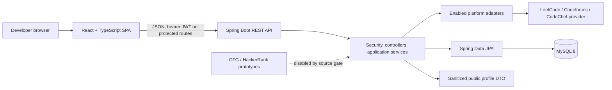

# KodBTW

## Unified Coding Identity & Campus Coding Intelligence Platform

KodBTW brings coding-platform profiles, persisted statistics, dashboard analytics, historical progress, and public developer profiles into one application. It helps users understand their coding progress and can help strengthen their resumes. The platform also provides account-scoped dashboards, leaderboard views, and a contest calendar. Source coverage and permissions differ by platform; see the integration status below before interpreting any metric.

> **Academic project context** — Project information below was supplied for this documentation task and has not been independently verified against college records. Confirm it before final academic submission.

| Field | Information |
|---|---|
| Project code | `PBL2627-CSE-C-064` |
| Type / course | Website application / Project Based Learning (PBL), Java Projects, 5th Semester |
| Department / specialisation | CSE-C / AI&DS / IT (confirm applicable specialisation) |
| Institution | Arya College of Engineering & I.T., Jaipur, Rajasthan |
| Academic year | 2026–27 |
| Project guide | Er. Ram Babu Buri, Department of CSE |
| Project duration | 6 July 2026 to 6 October 2026 |

## Contents

- [Abstract](#abstract)
- [Problem statement](#problem-statement)
- [Objectives and scope](#objectives-and-scope)
- [Features and implementation status](#features-and-implementation-status)
- [Technology stack](#technology-stack)
- [Architecture and modules](#architecture-and-modules)
- [Platform integrations](#platform-integrations)
- [Data model](#data-model)
- [Team and contributions](#team-and-contributions)
- [Testing and validation](#testing-and-validation)
- [Screenshots](#screenshots)
- [Run locally](#run-locally)
- [Configuration](#configuration)
- [Repository layout](#repository-layout)
- [Project Documentation and Deliverables](#project-documentation-and-deliverables)
- [Limitations and future work](#limitations-and-future-work)
- [Licence](#licence)

## Abstract

Coding activity and identity are spread across separate competitive-programming services. KodBTW provides one place to connect supported public profiles, view available platform data with source/status context, retain historical snapshots, and share selected profile information. A user account is required for dashboard and account-management features; public profiles are available through a separate public endpoint.

## Problem statement

Developers who use multiple coding platforms must visit each service separately to review their profiles and progress. A unified view is useful only when source, freshness, and missing data are made clear.

## Objectives and scope

**Objectives:** provide account registration and authentication; connect platform handles; retrieve and persist supported statistics; present dashboard, history, and analytics views; and provide a public profile route.

**Scope:** the application includes the frontend, REST API, persistence, platform adapters, and local development workflow in this repository. It does not establish authorization to retrieve or redistribute third-party statistics, guarantee upstream availability, or include academic reports that are not present in the repository.

## Features and implementation status

| Feature | What the repository implements | Status / boundary |
|---|---|---|
| Account registration and login | Spring Security, BCrypt password hashing, stateless JWT bearer authentication | Implemented; see tests and source links below |
| Profile management | Owner-scoped profile read/update and unique public username | Implemented |
| Platform accounts | Add, read, update, delete, inspect status, and manually sync an owned account | Implemented; stats depend on enabled source |
| Dashboard and analytics | Overview, difficulty/platform metrics, history, insights, and activity/contest intelligence | Implemented; missing source values remain unavailable rather than fabricated |
| Public developer profile | Dedicated response DTO and `/u/:username` frontend view | Implemented; separate public endpoint, not a raw user-entity export |
| Leaderboard | Authenticated, paginated/sortable leaderboard with real-source filtering and a cached projection | Implemented; manual cache sync is admin-only |
| Contest calendar | Authenticated contest calendar with Codeforces provider and an explicitly selected local fixture provider | Implemented; fixture data is illustrative, not live contest data |
| Responsive UI, theme, and accessibility | React layouts, light/dark theme, keyboard/accessibility markup, and automated contrast/markup checks | Implemented; this repository audit is not a full device/browser audit |

“Implemented” describes code in the current working tree. GFG and HackerRank adapter/client work currently present in the local working tree is not enabled for normal sync. Do not treat the platform status table as a claim of production authorization.

## Technology stack

| Layer | Technology | Purpose |
|---|---|---|
| Frontend | React 18, TypeScript 5.6, React Router 6 | Single-page user interface and routing |
| Frontend tooling | Vite 5.4, npm | Development server and production asset build |
| Backend | Java 21, Spring Boot 3.3, Spring Web | REST API and application services |
| Persistence | Spring Data JPA / Hibernate | Entity persistence and repository access |
| Database | MySQL 8 | Application records and statistics snapshots |
| Schema management | Flyway (migrations V1–V7) | Ordered database schema changes; Hibernate validates rather than creates the schema |
| Authentication | Spring Security, BCrypt, JJWT 0.12 | Stateless bearer-token authentication and password hashing |
| External data | Platform-specific HTTP clients; Codeforces contest provider | Public profile/contest data acquisition, subject to source limitations |
| Backend build/tests | Maven wrapper, JUnit/Spring Boot Test, H2, Testcontainers | Reproducible Java build and automated tests |
| Frontend tests | Node.js built-in test runner | Utility, presentation, markup, and request behavior tests |
| CI | GitHub Actions backend workflow | Runs backend test/package job; requires Docker for Testcontainers |
| Packaging | Backend Dockerfile; Vercel SPA configuration | Container image and frontend static build configuration; host account/deployment is not defined by repository manifests |

## Architecture and modules

The browser application calls a stateless Spring REST API. Controllers delegate to services; repositories use JPA entities backed by MySQL. Platform sync resolves a `PlatformAdapter` through `PlatformAdapterRegistry`, normalizes supported fields into `PlatformStats`, and persists source-labelled snapshots. Unsupported sources return unavailable/pending status and are not converted to verified data.



See the [system architecture diagram](documentation/diagrams/architecture/SYSTEM_ARCHITECTURE.md), [system-design diagrams](documentation/diagrams/system-design/README.md), [UML index](documentation/diagrams/uml/README.md), and [database schema and ER diagram](documentation/diagrams/database/README.md).

### Core modules

| Module | Main code |
|---|---|
| Authentication and security | `backend/src/main/java/com/kodbtw/controller/AuthController.java`, `service/AuthService.java`, `security/`, `config/SecurityConfig.java` |
| Profiles and public sharing | `controller/ProfileController.java`, `controller/PublicProfileController.java`, `service/ProfileService.java`, `service/PublicProfileService.java` |
| Platform connection and sync | `controller/PlatformAccountController.java`, `service/PlatformAccountService.java`, `service/PlatformSyncService.java`, `adapter/` |
| Dashboard, history, and analytics | `controller/DashboardController.java`, `service/Dashboard*Service.java`, `dto/analytics/`, `dto/history/`, `dto/insights/` |
| Leaderboard | `controller/LeaderboardController.java`, `service/LeaderboardService.java`, `service/LeaderboardSyncService.java`, `entity/LeaderboardUserCache.java` |
| Contest calendar | `controller/ContestCalendarController.java`, `service/ContestCalendarService.java`, `adapter/contest/` |
| Frontend routes and views | `frontend/src/App.tsx`, `frontend/src/pages/`, `frontend/src/components/` |

### Main workflows

1. **Register/login:** the frontend posts credentials to `/api/auth/register` or `/api/auth/login`; the backend validates input, hashes registration passwords with BCrypt, and returns a signed JWT after login. Protected API requests send the token in `Authorization: Bearer …`; the JWT filter validates it and resolves the user from the database.
2. **Connect and sync a profile:** an authenticated user adds a platform account. The backend checks account ownership for subsequent operations. When the source is enabled, sync fetches and validates upstream data, records status and source-tagged snapshots, and returns the current result. Cooldown, serialization, unavailable source, and upstream failure paths are handled by the sync service; failed syncs preserve prior successful data.
3. **Review or share progress:** dashboard endpoints return owner-scoped metrics and persisted history. A public profile request uses `/api/public/profiles/{username}` and returns a dedicated response DTO rather than exposing the user entity.
4. **Contest calendar:** the authenticated frontend requests `/api/contests`. The configured provider is Codeforces by default; local fixture mode is opt-in and clearly labelled.

Detailed request paths, data stores, and failure branches are shown in the [authentication and sync diagrams](documentation/diagrams/system-design/README.md). Supporting source references are linked from the [workflow UML](documentation/diagrams/uml/README.md).

## Platform integrations

| Platform | Current code status | Important limitation |
|---|---|---|
| LeetCode | Adapter and GraphQL client are used for live profile statistics and mark data `LEETCODE_REAL` | The profile query uses a publicly reachable but undocumented endpoint; upstream contract and terms should be reviewed. Only fields present in the response are mapped. |
| Codeforces | Adapter uses the public `user.info` API and marks data `CODEFORCES_REAL`; contest calendar uses a Codeforces contest provider | `user.info` does not supply all problem-solving or activity fields. Those remain null. The current and maximum rating are separate fields. |
| CodeChef | Adapter calls an unofficial third-party stats provider; data is marked `CODECHEF_THIRD_PARTY` | Not an official CodeChef API. Provider authorization, upstream permission, data rights, and reliability are unresolved; do not present as production-cleared. |
| GeeksforGeeks | Adapter/client prototype files exist in the current local working tree | `Platform.hasLiveStatsSource()` excludes GFG, so normal sync does not invoke it; status remains source-pending/unavailable. Source authorization is unresolved. |
| HackerRank | Adapter/client prototype files exist in the current local working tree | `Platform.hasLiveStatsSource()` excludes HackerRank, so normal sync does not invoke it; status remains source-pending/unavailable. Source authorization is unresolved. |

There are test fixtures and mock-source handling, but the current application does not make GFG/HackerRank live statistics available through the sync lifecycle. See the detailed [platform acquisition record](docs/platform-data-acquisition.md) and [platform integration diagram](documentation/diagrams/platform-integration/README.md). No permission requests are represented as sent or approved.

## Data model

The main persisted entities are `User`, `Profile`, `PlatformAccount`, `PlatformStatSnapshot`, and `LeaderboardUserCache`. The migrations also create a standalone `schema_initialization_check` table. Important cardinalities include one profile per user, many platform accounts and dated stat snapshots per user, and an optional one-to-one leaderboard cache projection per user. See the [ER diagram and schema notes](documentation/diagrams/database/README.md) and `backend/src/main/resources/db/migration/` for authoritative DDL.

## Team and contributions

The five names below were supplied from the college project portal for this README. Module-level work is left pending team verification because the available Git history is not sufficient evidence of complete individual responsibilities.

| Team member | Contribution record |
|---|---|
| Sajal Goyal | Contribution details pending team verification. |
| Shri Krishna Chandra Vaishnav | Contribution details pending team verification. |
| Yug Mittal | Contribution details pending team verification. |
| Ravi Shah | Contribution details pending team verification. |
| Suryadev Singh | Contribution details pending team verification. |

See the [module-wise contribution matrix](documentation/TEAM_CONTRIBUTIONS.md). The inspected Git history has commits authored under Sajal Goyal and Shri Krishna Chandra Vaishnav, but authorship and commit counts do not establish complete task ownership. Confirm contributions with the whole team before submission.

## Testing and validation

The repository contains Java unit/integration tests, adapter/client tests, controller/security tests, Flyway migration checks, and frontend Node tests. The configured GitHub Actions workflow runs the backend Maven `test package` job and uploads Surefire reports; Docker is required for the Testcontainers step. There is no configured frontend CI or end-to-end browser suite in this repository.

Current validation results are recorded in [Testing and Validation](documentation/TESTING_AND_VALIDATION.md). Do not infer production performance, deployment health, external-source authorization, or manual browser coverage from automated test results.

## Screenshots

No genuine application screenshots were found in the repository during this audit. The Open Graph social image is promotional artwork, not evidence of an application screen, so it is not presented as a screenshot. Add reviewed, privacy-safe captures to `documentation/screenshots/` when available; see the [screenshot index](documentation/screenshots/INDEX.md).

## Run locally

### Prerequisites

- Java 21
- MySQL 8
- Node.js 18+ and npm
- Docker for backend Testcontainers tests

Create an empty local database and a development user with appropriate privileges:

```sql
CREATE DATABASE kodbtw CHARACTER SET utf8mb4 COLLATE utf8mb4_0900_ai_ci;
```

Set backend variables in the process environment or a secret manager. `.env.example` is a reference only; Spring Boot does not automatically load it. Use a fresh local JWT secret of at least 32 random bytes and never commit populated environment files.

Example PowerShell setup (prompts for local MySQL credentials and generates a session-only JWT secret):

```powershell
$env:DB_URL = "jdbc:mysql://127.0.0.1:3306/kodbtw?useSSL=false&allowPublicKeyRetrieval=true&serverTimezone=UTC"
$env:DB_USERNAME = Read-Host "Local MySQL username"
$secureDbPassword = Read-Host "Local MySQL password" -AsSecureString
$env:DB_PASSWORD = [System.Net.NetworkCredential]::new("", $secureDbPassword).Password
$secretBytes = New-Object byte[] 32
[System.Security.Cryptography.RandomNumberGenerator]::Fill($secretBytes)
$env:JWT_SECRET = [Convert]::ToBase64String($secretBytes)
$env:CORS_ALLOWED_ORIGINS = "http://localhost:5173,http://127.0.0.1:5173"
```

Start the backend from `backend/`:

```powershell
.\mvnw.cmd test
.\mvnw.cmd package
.\mvnw.cmd spring-boot:run
```

Start the frontend from `frontend/` in another terminal:

```powershell
npm ci
npm run dev
```

Vite listens on port `5173` and proxies `/api` to `http://localhost:8080` in development. Flyway applies migrations V1–V7; Hibernate validates the schema (`ddl-auto: validate`) and does not create/update tables. The default contest calendar provider is Codeforces. For isolated UI tests, see [`docs/contest-calendar-fixture-mode.md`](docs/contest-calendar-fixture-mode.md).

## Configuration

| Variable | Purpose | Requirement/default |
|---|---|---|
| `DB_URL` | MySQL JDBC URL | Required |
| `DB_USERNAME` / `DB_PASSWORD` | Database credentials | Required; use a least-privilege account |
| `JWT_SECRET` | JWT HMAC signing key | Required; at least 32 random bytes |
| `JWT_EXPIRATION_MS` | JWT lifetime | Defaults to 86,400,000 ms (24 hours) |
| `CORS_ALLOWED_ORIGINS` | Exact allowed browser origins | Local defaults in base config; required by production profile |
| `PORT` | Backend HTTP port | Defaults to `8080` |
| `VITE_API_BASE_URL` | Public API origin compiled into frontend assets | Empty by default for relative `/api` requests; never put secrets here |
| `CONTEST_CALENDAR_PROVIDER` | Contest source selection | `codeforces` by default; `fixture` is a local test option |
| `CONTEST_CALENDAR_FIXTURE_SCENARIO` | Fixture scenario | `multiple` by default when fixture mode is selected |
| `CONTEST_CALENDAR_CACHE_TTL` | Contest cache age | `PT10M` by default |
| `PLATFORM_SYNC_COOLDOWN` | Per-account sync cooldown | `PT15M` by default |

Production settings are described in `backend/src/main/resources/application-prod.yml`. The backend Dockerfile builds/runs with Java 21 and a non-root runtime user. Vercel SPA rewrite configuration is in `frontend/vercel.json`. These files document packaging/configuration; deployment accounts and live infrastructure are not included in the repository.

## API overview

All backend routes use the `/api` prefix. Except where listed public, routes require a valid bearer token.

| Method / route | Access and purpose |
|---|---|
| `POST /api/auth/register`, `POST /api/auth/login` | Public registration and login |
| `GET /api/auth/me` | Authenticated current user |
| `GET /api/health` | Public liveness response; not a database-readiness check |
| `GET /api/profile`, `PUT /api/profile` | Authenticated owner profile |
| `GET /api/public/profiles/{username}` | Public sanitized profile response |
| `/api/platform-accounts/**` | Authenticated, owner-scoped account and sync operations |
| `/api/dashboard/**` | Authenticated owner-scoped overview, analytics, history, insights, activity, and contests |
| `GET /api/contests` | Authenticated contest calendar |
| `/api/leaderboard/**` | Authenticated leaderboard/rank reads; `POST /api/leaderboard/sync` requires `ADMIN` |

Controller annotations are the route source of truth; see `backend/src/main/java/com/kodbtw/controller/`.

## Repository layout

```text
backend/                         Spring Boot API, migrations, tests, Dockerfile
  src/main/java/com/kodbtw/      controllers, services, adapters, entities, DTOs
  src/main/resources/db/         Flyway V1–V7 migrations
  src/test/                      Java tests and provider fixtures
documentation/                   Academic-facing indexes, diagrams, test record
  diagrams/                      Architecture, design, UML, ER, integrations
  screenshots/                   Screenshot index; captures not yet present
  weekly-reports/                 Weekly report index; reports not yet present
docs/                             Existing technical notes and acquisition research
frontend/                         React/TypeScript/Vite client and tests
  public/                         Static assets, robots, sitemap, verification file
  src/                            Routes, pages, components, services, tests
.github/workflows/                Backend CI workflow
```

## Project Documentation and Deliverables

Local technical documentation is linked directly. External academic share links remain blank for the team to fill in later.

| Deliverable | Local repository material | External submission link |
|---|---|---|
| Software Requirements Specification (SRS) | Not found in this checkout | [Add SRS link]() |
| Final Project Report | Not found in this checkout | [Add final report link]() |
| IEEE-format Research Paper | Not found in this checkout | [Add research paper link]() |
| Weekly Reports | [Weekly report index](documentation/weekly-reports/INDEX.md); individual reports not found | [Add weekly reports link]() |
| Daily Progress Logs | Not found in this checkout | [Add progress log link]() |
| Literature Review | Not found as an academic deliverable; see technical [platform data-acquisition record](docs/platform-data-acquisition.md) | [Add literature review link]() |
| Repository audit and system architecture | [Audit findings](documentation/PROJECT_AUDIT.md), [architecture diagram](documentation/diagrams/architecture/SYSTEM_ARCHITECTURE.md), and [technical notes](docs/ARCHITECTURE.md) | [Add architecture link]() |
| UML Diagrams | [UML index](documentation/diagrams/uml/README.md) | [Add UML link]() |
| ER Diagram / Database Schema | [Database documentation](documentation/diagrams/database/README.md) | [Add ER/schema link]() |
| Platform Integration Design | [Integration diagram and status](documentation/diagrams/platform-integration/README.md) | [Add integration design link]() |
| Team Contributions | [Contribution matrix](documentation/TEAM_CONTRIBUTIONS.md); details pending team verification | [Add team contribution link]() |
| Testing Documentation | [Testing and validation record](documentation/TESTING_AND_VALIDATION.md) | [Add testing documentation link]() |
| Application Screenshots | [Screenshot index](documentation/screenshots/INDEX.md); genuine captures not found | [Add screenshots link]() |
| Project Presentation / PPT | Not found in this checkout | [Add presentation link]() |
| Project Demonstration Video | Not found in this checkout | [Add demo video link]() |
| Final Deliverables Checklist | [Repository checklist](FINAL_DELIVERABLES_CHECKLIST.md) | [Add checklist link]() |

Weekly progress and research links are also indexed in the [weekly reports](documentation/weekly-reports/INDEX.md) and [platform acquisition record](docs/platform-data-acquisition.md). The latter is technical source research, not a substitute for the required academic literature review.

## Limitations and future work

- Upstream platform schemas, terms, rate limits, and service availability can change. LeetCode’s profile query is undocumented; CodeChef uses an unofficial provider with unresolved permission and reliability; GFG/HackerRank local prototypes are not enabled in regular sync.
- Available metrics vary by platform. Missing values remain null/unavailable; ratings from different platforms are not directly equivalent.
- Repository tests do not establish production uptime, external data accuracy, privacy-policy compliance, or authorization to acquire/display third-party statistics.
- The frontend uses client-side routing. Hosting configuration rewrites routes to the SPA; unknown-route HTTP status behavior and server-rendered metadata are not implemented here.
- Possible future work, subject to team approval and platform authorization, includes official/approved data contracts, richer accessible browser/E2E coverage, server-rendered public profile metadata, and deployment/operations documentation. These are not claims of completed work.

## Licence

No root-level licence file was found in this checkout. Reuse and redistribution terms are therefore not stated here; confirm the intended project licence with the project owners.
