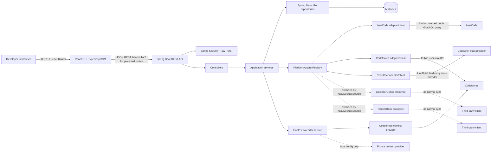

# System architecture

This editable Mermaid diagram follows the current repository code. Solid paths represent configured application relationships; dashed paths show disabled prototypes or optional/local behavior.

## Responsibilities and data flow

- The React/Vite frontend renders public and authenticated routes and sends API requests. The development Vite proxy forwards `/api` to the local backend; production API origin is selected by build configuration or same-origin hosting.
- Spring controllers validate/map HTTP requests and delegate to services. Spring Security is stateless; the JWT filter validates bearer tokens, looks up the user, and protected services/controllers use that identity for owner-scoped operations.
- Services coordinate domain behavior, including profiles, platform account ownership, sync status, analytics, snapshots, public-profile DTOs, and leaderboard cache rebuilding.
- `PlatformAdapterRegistry` resolves adapter implementations. Supported sync results are normalized and persisted with source labels. Unsupported platform values are returned as pending/unavailable instead of being fabricated.
- Repositories persist data via JPA to MySQL. Flyway owns DDL and Hibernate uses `ddl-auto: validate`.
- CodeChef's external source is an unofficial third-party provider and has unresolved permission/reliability concerns. GFG/HackerRank adapter/client prototypes are present locally but excluded from normal sync.
- Repository deployment artifacts include a Vite SPA build/Vercel rewrite and backend Dockerfile. They describe packaging/configuration; the repository does not verify a live hosting account or complete infrastructure topology.

## Source references

`frontend/src/App.tsx`; `backend/src/main/java/com/kodbtw/config/SecurityConfig.java`; `security/JwtAuthenticationFilter.java`; `controller/`; `service/`; `adapter/PlatformAdapter.java`; `adapter/PlatformAdapterRegistry.java`; `service/PlatformSyncService.java`; `entity/`; Flyway migrations under `backend/src/main/resources/db/migration/`.
