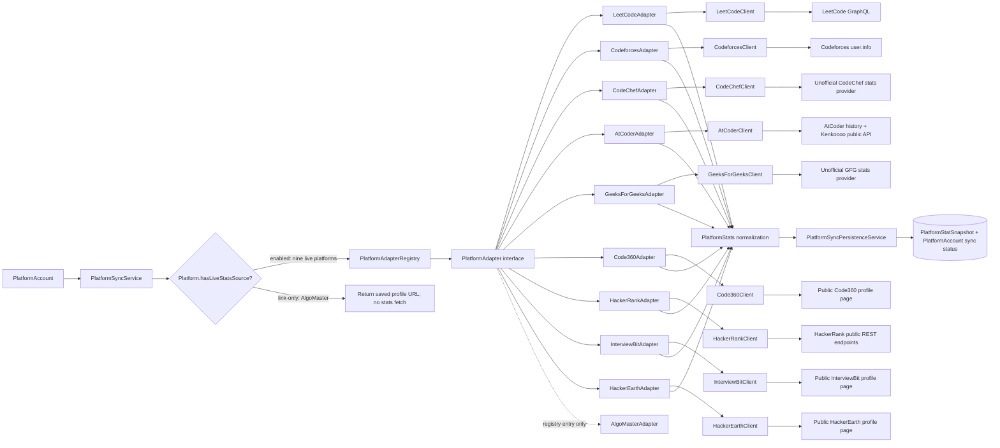

# Platform integration design

## Integration status

| Platform | Adapter/client | Runtime sync | Source label | Metrics / caveat |
|---|---|---|---|---|
| LeetCode | `LeetCodeAdapter` / `LeetCodeClient` | Enabled | `LEETCODE_REAL` | Uses an undocumented public GraphQL query; fields absent from response remain null. |
| Codeforces | `CodeforcesAdapter` / `CodeforcesClient` | Enabled | `CODEFORCES_REAL` | Uses public `user.info`; max rating is stored separately, and unsupported solve/contest metrics remain null. |
| CodeChef | `CodeChefAdapter` / `CodeChefClient` | Enabled | `CODECHEF_THIRD_PARTY` | Unofficial external stats provider. Permission, upstream rights, and reliability are unresolved. |
| AtCoder | `AtCoderAdapter` / `AtCoderClient` | Enabled | `ATCODER_REAL` | Combines public AtCoder rating history with Kenkoooo's public accepted-count and submission APIs. |
| GeeksforGeeks | `GeeksForGeeksAdapter` / `GeeksForGeeksClient` | Enabled | `GEEKSFORGEEKS_THIRD_PARTY` | Unofficial external stats provider. Permission, upstream rights, and reliability are unresolved. |
| Code360 (CodeStudio) | `Code360Adapter` / `Code360Client` | Enabled | `CODE360_THIRD_PARTY` | Parses the public Naukri Code360 profile page; markup changes fail safely and preserve prior snapshots. |
| HackerRank | `HackerRankAdapter` / `HackerRankClient` | Enabled | `HACKERRANK_REAL` | Uses public, undocumented profile, badge, and ELO-score REST endpoints. Difficulty breakdowns remain unavailable. |
| InterviewBit | `InterviewBitAdapter` / `InterviewBitClient` | Enabled | `INTERVIEWBIT_REAL` | Parses the public InterviewBit profile page; only explicitly parsed numeric fields are mapped. |
| HackerEarth | `HackerEarthAdapter` / `HackerEarthClient` | Enabled | `HACKEREARTH_REAL` | Parses the public HackerEarth profile page; only explicitly parsed numeric fields are mapped. |
| AlgoMaster | `AlgoMasterAdapter` | Link-only | `ALGOMASTER_LINK_ONLY` (never persisted or aggregated) | Saves and displays a public profile URL. Excluded by `Platform.hasLiveStatsSource()`, so no statistics are fetched. |

Provider failures are classified and persisted as sync failures without replacing the prior successful snapshot with mock values. Manual and scheduled sync share the cooldown and sync gate; Codeforces requests also have call spacing. Provider client tests use stubbed HTTP responses and do not verify live provider permission or service reliability. Link-only `LINK_ONLY` rows are rejected by `PlatformStatsSourcePolicy`, so they cannot affect totals, analytics, history, or leaderboards.

## Source references

`backend/src/main/java/com/kodbtw/adapter/PlatformAdapter.java`, `PlatformAdapterRegistry.java`, `entity/Platform.java`, `service/PlatformSyncService.java`, `service/PlatformSyncPersistenceService.java`, `service/PlatformStatsService.java`, `service/PlatformStatsSourcePolicy.java`, platform adapter/client packages, and `docs/platform-data-acquisition.md`.
