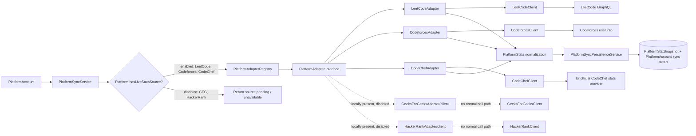

# Platform integration design

## Integration status

| Platform | Adapter/client | Runtime sync | Source label | Metrics / caveat |
|---|---|---|---|---|
| LeetCode | `LeetCodeAdapter` / `LeetCodeClient` | Enabled | `LEETCODE_REAL` | Uses an undocumented public GraphQL query; fields absent from response remain null. |
| Codeforces | `CodeforcesAdapter` / `CodeforcesClient` | Enabled | `CODEFORCES_REAL` | Uses public `user.info`; max rating is stored separately, and unsupported solve/contest metrics remain null. |
| CodeChef | `CodeChefAdapter` / `CodeChefClient` | Enabled | `CODECHEF_THIRD_PARTY` | Unofficial external stats provider. Permission, upstream rights, and reliability are unresolved. |
| GeeksforGeeks | Adapter/client prototype files are present in local working tree | Disabled: absent from `Platform.hasLiveStatsSource()` | Proposed adapter label is third-party, but not persisted via normal sync | Source authorization unresolved; keep unavailable. |
| HackerRank | Adapter/client prototype files are present in local working tree | Disabled: absent from `Platform.hasLiveStatsSource()` | Proposed adapter label is third-party, but not persisted via normal sync | Source authorization unresolved; keep unavailable. |

Provider failures are classified and persisted as sync failures without replacing the prior successful snapshot with mock values. Manual and scheduled sync share the cooldown and sync gate; Codeforces requests also have call spacing. Provider client tests commonly use stubbed responses and do not verify live provider permission or service reliability.

## Source references

`backend/src/main/java/com/kodbtw/adapter/PlatformAdapter.java`, `PlatformAdapterRegistry.java`, `entity/Platform.java`, `service/PlatformSyncService.java`, `service/PlatformSyncPersistenceService.java`, `service/PlatformStatsService.java`, platform adapter/client packages, and `docs/platform-data-acquisition.md`.
