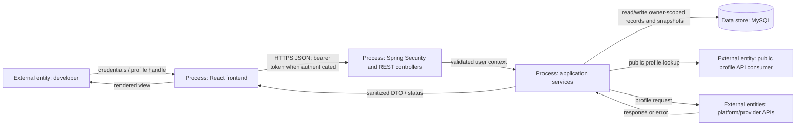
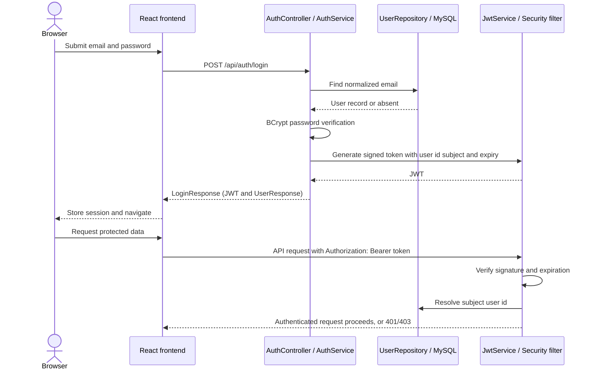
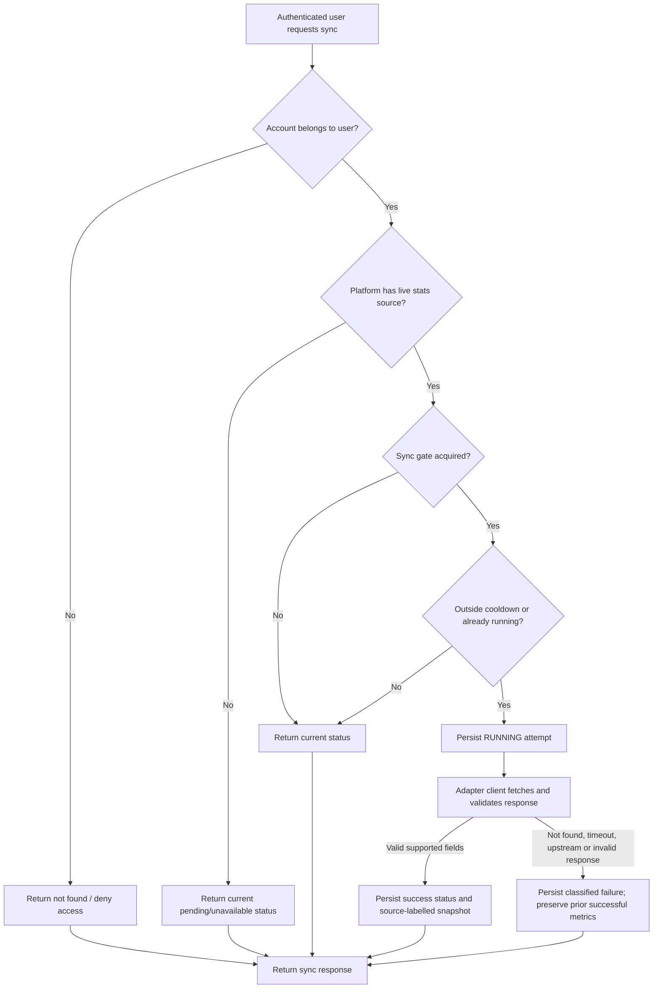
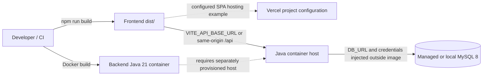

# System-design diagrams

The diagrams are authored as Mermaid in Markdown so their source remains editable and GitHub can render them. No separately exported PNG/SVG is checked in; visual export can be added when a renderer is available and the diagrams are reviewed.

## Data-flow diagram

**Boundary:** profile API consumers can request only a public username route. Private dashboard/profile/account methods require authentication. The public response is assembled by `PublicProfileService`; it is not a raw `User` entity export.

## Authentication sequence

Registration uses `POST /api/auth/register`, validates input, hashes the password, persists the user, and returns a user response. Profile data is managed separately through `/api/profile`. See `AuthController`, `UserService`, `AuthService`, `JwtService`, `JwtAuthenticationFilter`, and `SecurityConfig` for exact behavior.

## Platform sync activity

The normal source gate currently enables LeetCode, Codeforces, and CodeChef. CodeChef uses an unofficial provider. Local GFG/HackerRank adapter clients are not invoked by normal sync. A global sync semaphore, per-account cooldown, Codeforces call spacing, status persistence, and no-mock-fallback behavior are implemented in `PlatformSyncService` and `PlatformSyncPersistenceService`.

## Deployment/configuration view

This is a deployment-capability diagram, not proof of current infrastructure. The Vercel rewrite config and Dockerfile are checked in; hosting accounts, database service configuration, secrets, and production deployment state are not defined by those files. See the root README deployment notes and `frontend/vercel.json` / `backend/Dockerfile`.
