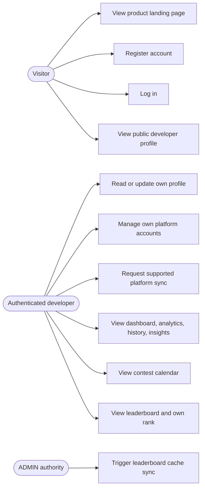
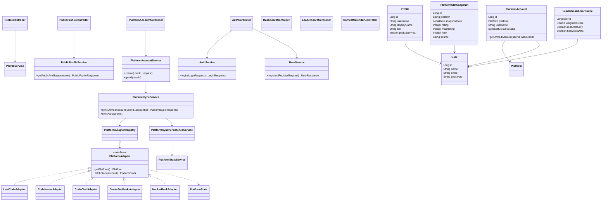
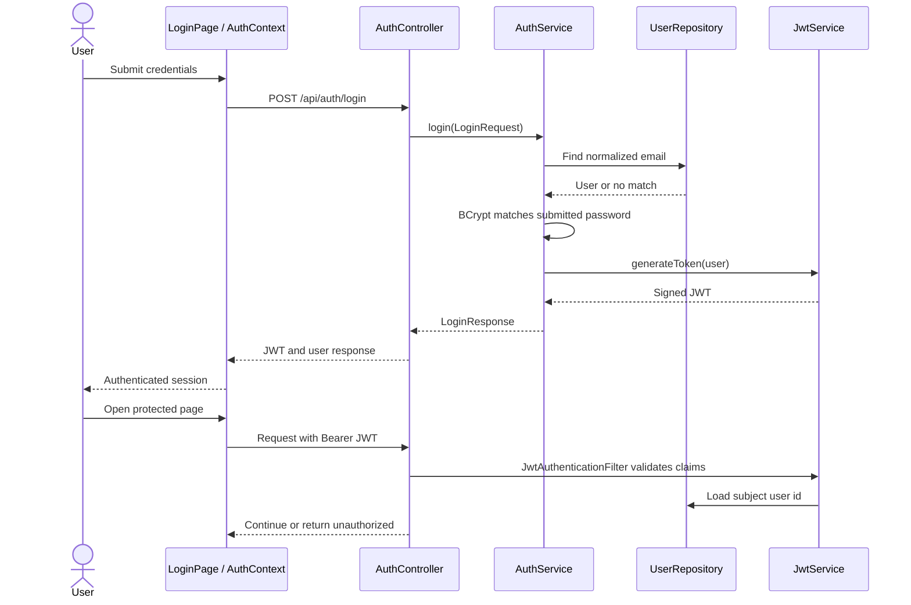

# UML diagrams

These source diagrams use Mermaid and are rendered by GitHub when viewed as Markdown. They model the checked-out code paths; third-party permission and deployment assumptions are not modeled as facts.

## Use cases



## Component and domain class view



Adapter class presence does not mean its platform is enabled for regular sync: GFG and HackerRank are excluded by `Platform.hasLiveStatsSource()` in the current working tree.

## Authentication sequence



## Platform sync sequence

```mermaid
sequenceDiagram
  actor User
  participant UI as CodingProfilesPage / hook
  participant Controller as PlatformAccountController
  participant Sync as PlatformSyncService
  participant Registry as PlatformAdapterRegistry
  participant Adapter as Enabled PlatformAdapter
  participant Provider as Platform or provider API
  participant Store as PlatformSyncPersistenceService / MySQL
  User->>UI: Request refresh for account
  UI->>Controller: POST /api/platform-accounts/{id}/sync
  Controller->>Sync: syncOwnedAccount(userId, accountId)
  Sync->>Store: Verify account ownership
  Sync->>Sync: Check live-source gate, semaphore and cooldown
  Sync->>Store: Mark attempt RUNNING
  Sync->>Registry: Resolve platform adapter
  Registry->>Adapter: fetchStats(account)
  Adapter->>Provider: Request profile statistics
  Provider-->>Adapter: Response or upstream error
  Adapter-->>Sync: Normalized PlatformStats or exception
  alt Valid response
    Sync->>Store: Persist successful status and source-labelled stats
  else Failure
    Sync->>Store: Persist classified failure; preserve prior success
  end
  Sync-->>Controller: PlatformSyncResponse
  Controller-->>UI: Updated status/statistics
```

The source gate can return pending status before registry lookup for disabled sources. Account ownership is checked before sync. The response/error paths are implemented in `PlatformAccountController`, `PlatformSyncService`, and `PlatformSyncPersistenceService`.
